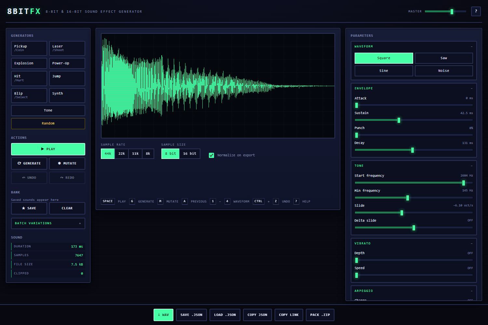

# 8bitFX

A retro **sound effect generator** that runs entirely in your browser — no build step, no
dependencies, no server. Click a generator, twiddle sliders, export a WAV.

It is a faithful JavaScript port of DrPetter's **sfxr** synthesis model (the same one behind
[sfxr.me](https://sfxr.me)): 8× oversampled rendering, square/saw/sine/noise oscillators,
punchy envelopes, pitch slides, vibrato, arpeggios, flanging and resonant filters, quantised to
**8-bit or 16-bit** PCM.



## Run it

Open `index.html` — that's it. Double-clicking works because the app uses classic scripts
(no ES modules, no `fetch`), so it runs straight from `file://`.

Optional, if you prefer a local server (VS Code **Live Server**, or any static server):

```
http://localhost:5500/index.html
```

You can deep-link a generator and format too:

```
index.html?preset=explosion
index.html?preset=laserShoot&rate=8000&bits=16
```

(`preset`: `pickupCoin`, `laserShoot`, `explosion`, `powerUp`, `hitHurt`, `jump`, `blipSelect`,
`synth`, `tone`, `random` · `rate`: any 4000–96000 Hz, with 44100/22050/11025/8000 offered as
chips · `bits`: 8, 16.)

## What you can do

| | |
|---|---|
| **Generators** | Pickup/Coin, Laser/Shoot, Explosion, Power-Up, Hit/Hurt, Jump, Blip/Select, Synth, Tone, Random — each randomised like sfxr's own presets |
| **Mutate** | Nudges every parameter a little so you can evolve a sound instead of re-rolling it |
| **23 sliders + 2 switches** | Waveform, envelope (attack / sustain / punch / decay), start frequency, min frequency, slide, delta slide, vibrato, arpeggio, duty cycle + sweep, retrigger, flanger, low-pass + high-pass filters, gain, DC blocker, waveform levelling |
| **Live scope** | Waveform preview redrawn on every change; drags render at reduced oversampling so long sounds stay responsive |
| **8-bit / 16-bit** | Sample size toggle, plus 44.1 k / 22.05 k / 11.025 k / 8 k sample rates |
| **Export** | WAV (mono PCM), JSON (sfxr-compatible parameter object), compact shareable permalink, and a **ZIP pack** of every banked sound |
| **Bank** | Save sounds to a persistent strip (localStorage, 24 slots), click to reload, `×` to delete |
| **Batch** | Roll 8 variations of the current generator and keep the best one |
| **A/B compare** | `A` plays the sound as it was before your last change |
| **Remembers your setup** | Open/collapsed panels, Normalize and Master volume persist in localStorage |
| **Undo / Redo** | `Ctrl`/`Cmd` + `Z`, and `Ctrl`/`Cmd` + `Shift` + `Z` to redo |

### Keyboard shortcuts

| Key | Action |
|---|---|
| `Space` | Play / replay |
| `G` | Generate a random sound |
| `M` | Mutate the current sound |
| `A` | Play the previous sound (A/B) |
| `1`–`4` | Square / Saw / Sine / Noise |
| `Ctrl`+`Z` | Undo |
| `Ctrl`+`Shift`+`Z` | Redo |
| `?` | Shortcut help |

Sliders also respond to a **double-click**, which restores that parameter's default.

## Exporting

- **WAV** — mono PCM at the selected rate/depth, named like `laserShoot-8bit-44k.wav`.
- **Normalize on export** (on by default) scales the sound to −1 dBFS so it sits at a
  comfortable level in a game. Turn it off if you want sfxr's raw, quieter output.
- **Save / Load .json** — the same parameter keys sfxr uses (`p_env_attack`, `p_base_freq`, …),
  so sound definitions can be moved between tools.
- **Copy link** — the parameter set travels in the URL fragment as a **31-byte payload**
  (~43 characters, starting `#3…`). Each knob is quantised to 1/255 of its range and the noise
  seed is carried, so a link reproduces the sound sample-for-sample; the sample rate is a full
  16-bit field, so 48 kHz survives too. Links made by older builds (`#2…` and the long
  base64-JSON form) still open.
- **Pack .zip** — every banked sound as a WAV in one archive. The ZIP writer is ~90 lines with no
  dependencies (store method, real CRC-32), and the archive has been verified against Windows'
  own `Expand-Archive`.

## How the synthesis works

Everything is generated by `js/synth.js` in a single loop running at **352 800 Hz**
(44.1 kHz × 8 oversampling). Per sub-sample:

```
envelope (attack → sustain+punch → decay)
→ pitch glide (multiplier slide + linear delta slide, clamped by min frequency)
→ arpeggio ladder → vibrato
→ oscillator (square/saw/sine/32-sample noise table, variable pulse width)
→ waveform levelling (all four shapes peak at ±0.5)
→ 1-pole low-pass with resonance feedback → 1-pole high-pass
→ flanger (8192-sample delay line) → 25 Hz DC blocker
→ × envelope
```

Sub-samples are averaged into one output sample using a fractional accumulator (so 8 kHz really
is 8 000 Hz, not 8 018 Hz), the gain is applied, and the result is quantised to 8-bit unsigned or
16-bit signed PCM. `js/params.js` holds the slider → DSP mapping (seconds, Hz, %, dB), which the
parameter readouts also use, so the numbers you see are the numbers being rendered.

If the sound ends at full level (decay = 0) the last millisecond is ramped down, so exported
files don't end on a click. While a slider is being dragged the preview renders at 4× oversampling
(2× for sounds longer than about 1.2 s) so long sounds stay responsive; releasing re-renders at
the full 8×, and anything you play deliberately or export is always upgraded to a full-quality
render first.

The noise table comes from a seeded `mulberry32` PRNG, which is why renders are deterministic and
share links reproduce a sound bit-for-bit.

## Tests

Open `tests.html` for the in-browser suite (41 checks: WAV headers, export helpers, determinism,
preset audibility, quantisation ranges, pitch accuracy, duration mapping, exact 8 kHz rate,
parameter codec (v3 payloads plus legacy links), non-preset sample rates, slider mapping, panel
construction, mutation validity, DC blocking for long and short sounds, waveform levelling, the
anti-click fade, ZIP structure and CRC-32, bank persistence, clipping detection, and a 120-sound
fuzz pass).

No Node needed — `test.cmd` runs two headless passes (the unit suite, then `index.html?selftest=1`
and its 14 app checks: chips, custom-rate legend, undo/redo, permalinks, the export-quality guard,
the WAV header, preferences, label coverage, duplicate IDs, horizontal overflow, the bank and the
ZIP writer) and exits non-zero if either fails. Manually:

```
chrome --headless=new --disable-gpu --virtual-time-budget=40000 --dump-dom tests.html
chrome --headless=new --disable-gpu --virtual-time-budget=25000 --dump-dom "index.html?selftest=1"
```

`tests.html?zip=1` and `?wav=1` dump a real archive / WAV as base64, which is how the two writers
were verified against Windows' `Expand-Archive` and `System.Media.SoundPlayer`.

## Deliberate deviations from sfxr

The sound is meant to match, but a few implementation details are cleaner than the original:

- **Flanger is bypassed when offset *and* sweep are both zero.** The original still sums the
  current sample with itself at zero delay, doubling the level of every sound.
- **Vibrato modulates the instantaneous period** rather than permanently multiplying the running
  period, so it warbles instead of drifting upwards.
- **High-pass is a proper 1-pole high-pass** (unity gain at 0 Hz cutoff) instead of a leaky
  integrator, so "OFF" means genuinely off.
- **Duration is capped at 4 s** and all params are clamped, so no slider combination can lock up
  the renderer.
- **A noise seed** is stored in the parameter set (sfxr has none) for reproducible shares.
- **DC blocker is on by default** — a 25 Hz high-pass after the flanger. Pulse-width squares and
  noise carry a DC offset in sfxr, which thumps when a sound is retriggered in a game. Switch it
  off for bit-exact sfxr parity. (Very short sounds — under ~30 ms — can only shed part of the
  offset; that is inherent to a high-pass, not a bug.)
- **Anti-click tail fade** — if a sound ends at full level (`decay = 0`, e.g. the Tone preset) the
  last millisecond is ramped down. sfxr ends on a step, which clicks.
- **Waveform levelling is on by default** — square already peaks at ±0.5 while saw/sine/noise peak
  at ±1, so sfxr's square presets are ~6 dB quieter than the others. Levelling scales all four to
  ±0.5 for consistent preset levels; switch it off to restore the original imbalance.
- **Permalinks use a compact 30-byte payload (v2)**; the previous JSON payload is still decoded.

## Layout

```
index.html          page shell
css/styles.css      retro console theme (responsive, keyboard-accessible)
js/rng.js           seeded mulberry32 PRNG
js/params.js        parameter definitions, slider mapping, display formatting
js/codec.js         permalinks: v3 binary payload, v2 + legacy decoders
js/bank.js          localStorage sound bank (24 entries)
js/prefs.js         persisted UI preferences (panels, normalize, volume)
js/zip.js           store-only ZIP writer used by the pack export
js/export.js        parameters -> WAV bytes in one call (export, pack, self-test)
js/io.js            downloads, clipboard, filenames, JSON sanity check
js/shortcuts.js     keyboard map
js/synth.js         the synthesis engine + quantiser
js/wav.js           RIFF/WAVE encoder (8-bit unsigned, 16-bit signed)
js/presets.js       generator heuristics + mutate()
js/audio.js         Web Audio playback
js/ui.js            parameter panel builder + oscilloscope + bank strip
js/selftest.js      the ?selftest=1 app checks
js/app.js           state, rendering, workflow, boot
tests.html          browser test suite
tests.js            the test suite itself
test.cmd            headless test runner (Chrome/Edge, no Node needed)
PARAMETERS.md       parameter reference: ranges, formulas, link format
.github/workflows/tests.yml   CI: runs test.cmd on windows-latest
```

## Credits

Algorithm and preset heuristics after **sfxr** by DrPetter, via **jsfxr** by Eric Fredricksen
and Chris McCormick (both released under the Unlicense). This port is a from-scratch ES5
implementation of that model. See `UNLICENSE`.
"# 8bitFX" 
